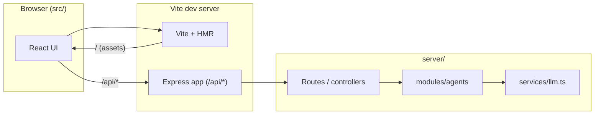
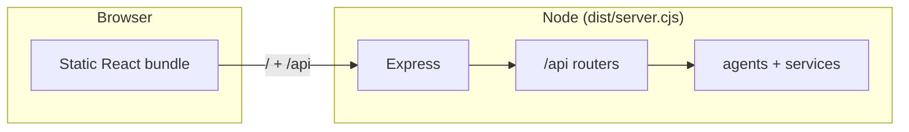

# InterviewLabs 🔬
> **AI-Powered Technical Interview Platform & Observability Platform**

InterviewLabs helps you prepare for technical interviews with AI-generated practice questions from your resume and optional job descriptions. Each session scores your answers and surfaces feedback so your next run can focus on weaker areas. The stack pairs a React client with an Express API, multi-agent LLM pipelines, and optional OpenTelemetry export for traces.

**[Open InterviewLab on DeepWiki](https://deepwiki.com/Devanshukoli/InterviewLab)** for an AI-generated walkthrough of this repository (same content as clicking through from the DeepWiki site).

---

## 🎯 Introduction

### What is InterviewLabs all about?
InterviewLabs bridges the gap between passive interview study and active, scenario-based technical evaluations. It reads uploaded resumes and job descriptions, parses technical requirements, constructs customized scenario questions (system design, troubleshooting, behavioral, and domain deep dives), evaluates candidate responses in real-time, and generates structured coaching reports. Crucially, the entire system is built like an enterprise production microservice, complete with OpenTelemetry tracing and Supabase persistence.

### Why should you take a look at this project?
Unlike typical tutorial projects or simple wrapper UI applications, InterviewLabs demonstrates **full-stack engineering rigor**:
- **Production Architecture**: Strict separation of concerns (Controllers, Services, DTOs, Routes, Middlewares) using Express and TypeScript.
- **Multi-Agent Orchestration**: Specialized modular agents (`/server/modules/agents`) for resume parsing, JD analysis, gap identification, question synthesis, answer evaluation, and career coaching.
- **Observability-First**: Built-in OpenTelemetry instrumentation (`@opentelemetry/sdk-node`) capturing trace spans across agent execution steps with an in-memory buffer route for debugging (`/api/telemetry`).
- **Enterprise Storage & RLS**: Complete SQL schema, indexes, triggers, 2FA support, and Row Level Security (RLS) designed for Supabase PostgreSQL (`/sql`), backed by an in-memory repository fallback layer (`/server/db.ts`).
- **Resilient AI Pipeline**: Abstracted LLM integration supporting Google Gemini API (`@google/genai`), OpenAI, and Anthropic SDKs with built-in retry and fallback capabilities.

### How is it useful for interview preparation compared to other platforms?
1. **JD-Matched Context**: Most platforms ask generic LeetCode or canned questions. InterviewLabs matches your real resume against a specific target Job Description to simulate the exact interviews companies will run.
2. **Deep Architectural Scenarios**: Questions probe system design trade-offs, fault tolerance, distributed tracing, and real production incidents rather than basic syntax trivia.
3. **Instant Actionable Feedback**: Answers are evaluated against missing technical concepts, clarity ratings, and architectural completeness with concrete suggestions for improvement.
4. **Learning Metric Trackers**: Automatically updates a confidence heat map across technical topics (e.g., OpenTelemetry, System Design, Node.js Concurrency) so you know exactly where your gaps are.

### By checking the code, what will you be able to study/learn yourself?
- **Modular Monolith Express Pattern**: How to organize clean, maintainable backend Express code into modular feature domains (`/server/api/*`).
- **Multi-Agent AI Engineering**: How to divide complex generative workflows into focused agent abstractions (`resume-agent`, `jd-agent`, `gap-agent`, `question-agent`, `evaluation-agent`, `coach-agent`).
- **OpenTelemetry Span Propagation**: How to instrument custom tracing spans across backend service workflows and surface telemetry logs via `/api/telemetry`.
- **Database Architecture & SQL RLS**: How to structure PostgreSQL schemas (`/sql/01_schema.sql` through `/sql/05_security_and_2fa.sql`), secure user tables with Supabase Row Level Security (`/sql/02_rls_policies.sql`), and maintain a unified repository fallback pattern (`/server/db.ts`).
- **Modern React 19 UI & Single-View Workflows**: How to construct sleek, high-contrast interfaces using React 19, Tailwind CSS v4, Lucide Icons, and Motion with zero visual clutter.

---

## 📁 Project Structure

InterviewLabs follows a modular layout: SQL migrations and shared types at the root, `server/` for the API and agents, and `src/` for the Vite + React client. In development, the Vite dev server attaches Express as middleware so `/api/*` calls hit the same process as the UI.

### Request flow (development)

When you run `npm run dev`, the browser talks to Vite. API calls route into Express middleware on the same origin.



### Request flow (production)

`npm run build` emits static frontend assets and `dist/server.cjs`. Production mode serves the built UI and forwards `/api` to the bundled Express app.



```
InterviewLabs/
├── .env.example                               # Template for required environment variables
├── .gitignore                                 # Git ignore file configuration
├── LICENSE                                    # Open-source license file
├── README.md                                  # Project documentation & structure reference
├── index.html                                 # HTML entry point with font loading & dark theme boot script
├── metadata.json                              # Applet metadata and frame capabilities
├── package.json                               # Dependencies, dev dependencies, and execution scripts
├── server.ts                                  # Root entry point executing server/index.ts
├── tsconfig.json                              # TypeScript compiler configuration
├── vite.config.ts                             # Vite configuration with Express API middleware integration
│
├── sql/                                       # PostgreSQL Database Migration Scripts
│   ├── 01_schema.sql                          # Core schema: users, resumes, job_descriptions, sessions, questions, evaluations
│   ├── 02_rls_policies.sql                    # Supabase Row Level Security (RLS) & auth triggers
│   ├── 03_seed_data.sql                       # Initial seed data for development & testing
│   ├── 04_resume_updates.sql                  # Schema additions for enhanced resume parsing & skill fields
│   ├── 05_security_and_2fa.sql                # 2FA/TOTP support, security logs, and rate-limiting persistent tracking
│   └── README.md                              # SQL execution instructions & schema breakdown
│
├── server/                                    # Enterprise Express Backend
│   ├── app.ts                                 # Express application setup (Helmet, CORS, Compression, API routes)
│   ├── bootstrap.ts                           # Server startup logic, DB initialization, and port listener
│   ├── config.ts                              # Zod-validated environment configuration loader
│   ├── db.ts                                  # Unified database interface with in-memory fallback & Supabase sync
│   ├── index.ts                               # Backend entry point initializing OTEL telemetry before booting app
│   ├── observability.ts                       # OpenTelemetry trace buffer and request tracing middlewares
│   │
│   ├── api/                                   # Domain API Controllers, Routes & Services
│   │   ├── index.ts                           # Master API router mounting sub-routes & applying rate-limiters
│   │   ├── auth/                              # Authentication module (JWT, Google OAuth, 2FA/TOTP)
│   │   │   ├── auth.controller.ts             # Auth HTTP request handlers (login, signup, TOTP, OAuth)
│   │   │   ├── auth.routes.ts                 # Auth route definitions
│   │   │   ├── auth.service.ts                # Auth business logic & credential verification
│   │   │   └── utils/crypto.ts                # Passwords, JWT generation, and encryption helpers
│   │   ├── billing/                           # Billing & subscription tier management
│   │   │   ├── billing.controller.ts          # Billing HTTP endpoint handlers
│   │   │   ├── billing.routes.ts              # Billing route definitions
│   │   │   └── billing.service.ts             # Subscription tier logic & limits verification
│   │   ├── history/                           # Interview session history & resume retrieval
│   │   │   ├── history.controller.ts          # History HTTP endpoint handlers
│   │   │   ├── history.routes.ts              # History route definitions (handles /history & /resumes alias)
│   │   │   └── history.service.ts             # History query service
│   │   ├── interview/                         # Interview practice session lifecycle & pipelines
│   │   │   ├── evaluation-pipeline.service.ts # Pipeline service executing evaluation & coaching agents
│   │   │   ├── interview-pipeline.service.ts  # Pipeline service coordinating resume, JD, gap, and question agents
│   │   │   ├── interview.controller.ts        # Interview HTTP endpoint handlers
│   │   │   ├── interview.routes.ts            # Interview route definitions
│   │   │   └── interview.service.ts           # Interview session state management
│   │   ├── profile/                           # Candidate profile & target career settings
│   │   │   ├── profile.controller.ts          # Profile HTTP endpoint handlers
│   │   │   ├── profile.routes.ts              # Profile route definitions
│   │   │   └── profile.service.ts             # Profile update business logic
│   │   ├── progress/                          # Skill mastery radar & progress tracking
│   │   │   ├── progress.controller.ts         # Progress HTTP endpoint handlers
│   │   │   ├── progress.routes.ts             # Progress route definitions
│   │   │   └── progress.service.ts            # Skill heatmap calculation service
│   │   └── telemetry/                         # OpenTelemetry observability endpoint
│   │       ├── telemetry.controller.ts        # Telemetry HTTP endpoint handler
│   │       ├── telemetry.routes.ts            # Telemetry route definitions
│   │       └── telemetry.service.ts           # Telemetry trace log extraction service
│   │
│   ├── dtos/                                  # Data Transfer Objects & Zod validation schemas
│   │   ├── auth.dto.ts                        # Auth request/response DTOs
│   │   ├── interview.dto.ts                   # Interview session request/response DTOs
│   │   └── profile.dto.ts                     # Profile management DTOs
│   │
│   ├── middleware/                            # Express Middlewares
│   │   ├── error_handling.ts                  # Global error handling and 404 middleware
│   │   ├── jwt.middleware.ts                  # JWT token authentication middleware
│   │   ├── rateLimit.ts                       # Rate limiters (general, auth, LLM generation)
│   │   ├── upload.ts                          # Multer file upload middleware (PDF/text resume ingestion)
│   │   ├── userContext.middleware.ts          # User context attachment middleware
│   │   └── validation.ts                      # Zod schema validation middleware
│   │
│   ├── modules/agents/                        # AI Multi-Agent Modules
│   │   ├── coach-agent.ts                     # Generates personalized study plans & actionable feedback
│   │   ├── evaluation-agent.ts                # Grades candidate answers against architectural rubric
│   │   ├── gap-agent.ts                       # Compares resume against JD to identify skill blind spots
│   │   ├── jd-agent.ts                        # Analyzes job descriptions for required competencies
│   │   ├── question-agent.ts                  # Synthesizes technical scenario questions
│   │   └── resume-agent.ts                    # Extracts skills, experience level, and tech stack from resumes
│   │
│   ├── observability/                         # OpenTelemetry Instrumentation
│   │   └── instrumentation.ts                 # Node SDK instrumentation setup with OTLP exporter
│   │
│   ├── services/                              # Infrastructure & Service Integrations
│   │   ├── evaluation-pipeline.service.ts     # Core evaluation orchestration service
│   │   ├── interview-pipeline.service.ts      # Core interview setup pipeline service
│   │   ├── llm.ts                             # Unified AI SDK wrapper (Gemini, OpenAI, Anthropic)
│   │   ├── prompt.service.ts                  # Structured prompt builder and prompt templates
│   │   ├── supabase.ts                        # Supabase JS client initializer & query wrapper
│   │   └── totp.ts                            # Time-based One-Time Password (2FA) verification service
│   │
│   └── utils/                                 # Server Utility Helpers
│       └── response.ts                        # Standardized API response formatters
│
└── src/                                       # Client-Side React Application (Vite + React 19)
    ├── App.tsx                                # Main application container, router state & auth sync
    ├── index.css                              # Tailwind CSS v4 directives & custom scrollbar styles
    ├── main.tsx                               # Application DOM root mount & theme boot
    ├── types.ts                               # Frontend component state type definitions
    │
    ├── components/                            # Modular React UI Components
    │   ├── ActiveInterviewSession.tsx         # Interactive session view: question timer, audio input & live AI feedback
    │   ├── AuthModal.tsx                      # Login, registration, password reset & 2FA modal
    │   ├── DashboardView.tsx                  # Candidate overview dashboard: metrics, recent sessions & quick actions
    │   ├── EvaluationReportView.tsx           # Comprehensive evaluation score breakdown & coaching recommendations
    │   ├── InterviewHistoryView.tsx           # Historical list of practice sessions with report review
    │   ├── LandingPage.tsx                    # Product showcase page & features overview
    │   ├── LearningProgressView.tsx           # Topic mastery radar, skill heatmap & progress graphs
    │   ├── NewInterviewFlow.tsx               # Session creation wizard: Resume picker, JD input & parameters
    │   ├── ResumeLibraryView.tsx              # Resume management, upload & parsed skill inspector
    │   ├── SettingsView.tsx                   # Account preferences, 2FA setup & AI provider configuration
    │   └── Sidebar.tsx                        # Collapsible primary navigation sidebar with keyboard shortcut
    │
    ├── lib/                                   # Frontend utilities
    │   ├── auth.ts                            # Token storage, refresh, and fetchWithAuth wrapper
    │   ├── app-route.ts                       # Client-side route state and URL sync
    │   ├── cookie-consent.ts                  # First-visit cookie preference storage
    │   ├── reading-font.ts                    # Reading font preference and preview
    │   └── theme.ts                           # Dark / light / system theme
    │
    └── shared/types/                          # Shared TypeScript Types (Frontend & Backend)
        ├── agent-types.ts                     # Types for multi-agent inputs, outputs & pipelines
        ├── api-types.ts                       # Standard API request and response interfaces
        ├── domain-types.ts                    # Core domain model interfaces (User, Session, Question, Evaluation)
        └── index.ts                           # Re-export barrel file for shared types
```

---

## 🏗️ Architecture & AI Pipeline Overview

### 🤖 Multi-Agent Orchestration
When a user launches a new practice session, InterviewLabs coordinates a multi-agent workflow:

1. **Resume Agent (`resume-agent.ts`)**: Ingests uploaded PDF or text resumes, extracting candidate tech stack, domain depth, experience level, and key projects.
2. **JD Agent (`jd-agent.ts`)**: Parses target Job Description text, mapping key responsibilities, mandatory system competencies, and preferred tools.
3. **Gap Agent (`gap-agent.ts`)**: Conducts a cross-comparison between the candidate's parsed resume and the JD requirements to locate primary skill gaps, domain blind spots, and key evaluation targets.
4. **Question Agent (`question-agent.ts`)**: Generates realistic, high-signal scenario questions tailored to the candidate's exact gaps and role level (System Design, Distributed Systems, SRE Troubleshooting, Behavioral).
5. **Evaluation Agent (`evaluation-agent.ts`)**: Analyzes submitted answers against architectural criteria, generating clarity scores, completeness metrics, and identifying missed concepts.
6. **Coach Agent (`coach-agent.ts`)**: Compiles overall session insights into structured study guidance, actionable recommendations, and updates topic mastery scores.

```
┌─────────────────┐     ┌──────────────┐     ┌───────────────┐
│  Parsed Resume  │  +  │  Parsed JD   │  ─> │   Gap Agent   │
└─────────────────┘     └──────────────┘     └───────┬───────┘
                                                     │
                                                     ▼
┌──────────────────┐     ┌─────────────┐     ┌───────────────┐
│ Candidate Answer │ ──> │ Evaluation  │ ──> │ Question Gen  │
└──────────────────┘     │    Agent    │     └───────────────┘
                         └──────┬──────┘
                                │
                                ▼
                         ┌─────────────┐
                         │ Coach Agent │
                         └─────────────┘
```

### Diagram


> Thanks to `https://gitdiagram.com/`

---

## 📋 Prerequisites

To run and inspect InterviewLabs locally, ensure you have the following installed:

- **Node.js**: `v18.x`, `v20.x`, or `v22.x`
- **Package Manager**: `npm` (v9+)
- **Google Gemini API Key**: Obtain a key from [Google AI Studio](https://aistudio.google.com/) for AI pipeline generation.
- **Supabase Account / Local CLI** *(Optional)*: For running production PostgreSQL schemas (`sql/01_schema.sql`).
- **OTLP Telemetry Collector** *(Optional)*: SigNoz, Jaeger, or Datadog listening on `http://localhost:4318` for OpenTelemetry trace export.

---

## ⚡ Quick Start & Development Setup

Follow these step-by-step instructions to get InterviewLabs running locally:

### Step 1: Clone & Install Dependencies
```bash
git clone https://github.com/Devanshukoli/InterviewLab.git
cd InterviewLab

# Install npm dependencies
npm install
```

### Step 2: Configure Environment Variables
Create a `.env` file in the project root by copying `.env.example`:
```bash
cp .env.example .env
```

Ensure your `.env` matches `.env.example`. Minimum for local AI calls:

```env
NODE_ENV=development
JWT_SECRET=your_jwt_secret_here
GEMINI_API_KEY=your_gemini_api_key_here
LLM_PROVIDER=gemini
```

Optional keys include Google OAuth (`GOOGLE_CLIENT_ID`, `GOOGLE_CLIENT_SECRET`), Supabase (`SUPABASE_URL`, `SUPABASE_ANON_KEY`, `SUPABASE_SERVICE_ROLE_KEY`), Bring Your Own Key encryption (`BYOK_ENCRYPTION_KEY`), and OpenTelemetry (`OTEL_SERVICE_NAME`, `OTEL_EXPORTER_OTLP_ENDPOINT`, default `http://localhost:4318`). See `.env.example` for the full list and comments.

### Step 3: Database Setup (Supabase / PostgreSQL)
If using Supabase or PostgreSQL:
1. Open your **Supabase Dashboard** -> **SQL Editor** (or local psql client).
2. Execute `/sql/01_schema.sql` to instantiate core tables, enums, constraints, and indexes.
3. Execute `/sql/02_rls_policies.sql` to enable Row Level Security policies and auth triggers.
4. Execute `/sql/03_seed_data.sql` to pre-populate default question templates and initial data.
5. Execute `/sql/04_resume_updates.sql` to apply resume field schema enhancements.
6. Execute `/sql/05_security_and_2fa.sql` to enable 2FA/TOTP tables and security log tracking.

*Note: If Supabase credentials are not provided in `.env`, InterviewLabs automatically operates in local in-memory fallback mode (`server/db.ts`).*

### Step 4: Launch Development Server
```bash
# Starts Express backend with Vite dev server on http://localhost:3000
npm run dev
```

The dev server listens on the port in `PORT` from `.env` (default `3000` in `server/config.ts`). Open `http://localhost:3000` unless you changed it.

### Step 5: Production Build & Run
To compile and test the production bundled build:
```bash
# Compiles Vite static assets & bundles backend server into dist/server.cjs
npm run build

# Start production Node server
npm run start
```

---

## 🔌 API Endpoints Reference

All API routes are prefixed under `/api` and protected with JWT authorization headers:

### Authentication (`/api/auth`)
- `POST /api/auth/register` - Create a new user account
- `POST /api/auth/login` - Authenticate user credentials & receive JWT token
- `GET /api/auth/me` - Fetch authenticated user profile
- `POST /api/auth/refresh` - Refresh access token
- `POST /api/auth/totp/setup` - Generate 2FA/TOTP secret & QR code
- `POST /api/auth/totp/verify` - Verify and enable 2FA

### Interview Sessions (`/api/interview`)
- `POST /api/interview/upload-resume` - Ingest PDF/text resume & extract technical profile
- `POST /api/interview/generate-questions` - Launch multi-agent pipeline to construct practice questions
- `POST /api/interview/start` - Initialize a new active practice session
- `POST /api/interview/evaluate` - Submit candidate response & receive AI evaluation score
- `POST /api/interview/complete` - Finalize practice session & generate coaching report
- `GET /api/interview/history` - List past practice sessions

### Candidate Resumes (`/api/resumes`)
- `GET /api/resumes` - List candidate's saved resumes
- `GET /api/resumes/:id` - Fetch resume details and extracted skills
- `DELETE /api/resumes/:id` - Remove a saved resume

### Learning Progress (`/api/progress`)
- `GET /api/progress` - Fetch topic mastery heatmaps & skill radar data
- `POST /api/progress/update` - Manual progress metric recalculation

### User Profile & Settings (`/api/profile` & `/api/billing`)
- `GET /api/profile` - Fetch candidate settings & target career preferences
- `PATCH /api/profile` - Update candidate target role, experience level, or preferred AI provider
- `GET /api/billing` - Fetch current subscription plan & quota usage

### Observability (`/api/telemetry`)
- `GET /api/telemetry` - Retrieve buffered OpenTelemetry trace spans, pipeline latency records, and execution logs

---

## ⚠️ Known gaps & roadmap

Tracked work lives in GitHub issues. Highlights as of the latest open list:

| Area | Issue |
|------|--------|
| CI/CD | [#47](https://github.com/Devanshukoli/InterviewLab/issues/47) |
| Security (LLM / BYOK) | [#49](https://github.com/Devanshukoli/InterviewLab/issues/49) |
| Prompt injection hardening | [#48](https://github.com/Devanshukoli/InterviewLab/issues/48) |
| Performance (latency) | [#50](https://github.com/Devanshukoli/InterviewLab/issues/50) |
| Better Auth migration | [#39](https://github.com/Devanshukoli/InterviewLab/issues/39) |
| Passkeys | [#9](https://github.com/Devanshukoli/InterviewLab/issues/9) |
| Alternate / additional database | [#10](https://github.com/Devanshukoli/InterviewLab/issues/10) |
| Memory bucket feature | [#41](https://github.com/Devanshukoli/InterviewLab/issues/41) |
| LeetCode suggestions from resume | [#40](https://github.com/Devanshukoli/InterviewLab/issues/40) |
| Billing checkout | [#12](https://github.com/Devanshukoli/InterviewLab/issues/12) |
| Feedback & review systems | [#8](https://github.com/Devanshukoli/InterviewLab/issues/8), [#7](https://github.com/Devanshukoli/InterviewLab/issues/7) |
| UI polish (landing, auth copy, dashboard) | [#36](https://github.com/Devanshukoli/InterviewLab/issues/36), [#38](https://github.com/Devanshukoli/InterviewLab/issues/38), [#21](https://github.com/Devanshukoli/InterviewLab/issues/21) |
| History pagination | [#27](https://github.com/Devanshukoli/InterviewLab/issues/27) |
| Resume preview | [#34](https://github.com/Devanshukoli/InterviewLab/issues/34) |
| Evaluation flow / question quality | [#20](https://github.com/Devanshukoli/InterviewLab/issues/20), [#11](https://github.com/Devanshukoli/InterviewLab/issues/11), [#3](https://github.com/Devanshukoli/InterviewLab/issues/3) |
| Cold start / demo video | [#33](https://github.com/Devanshukoli/InterviewLab/issues/33), [#16](https://github.com/Devanshukoli/InterviewLab/issues/16) |

Older README items such as async LLM queues, Redis session caching, Gemini Live audio, distributed rate limits, and a broader E2E suite are still valid directionally; they are not all filed as separate issues yet.

---

## 🔍 Troubleshooting Guide

### 1. Application & Server Boot Issues
- **Error**: `PORT 3000 in use` or server fails to bind.
  - **Check**: Verify if another process is running on port 3000 (`lsof -i :3000` or `netstat -ano | grep 3000`).
- **Error**: `GEMINI_API_KEY environment variable is required`.
  - **Check**: Confirm `.env` exists in the project root and `GEMINI_API_KEY` is set properly.

### 2. Inspecting OpenTelemetry Traces
- **Trace Buffer**: Query `http://localhost:3000/api/telemetry` in your browser to view buffered OpenTelemetry trace records, agent execution spans, and latency metrics.
- **Collector Integration**: If using SigNoz or Jaeger, verify the collector is receiving OTLP spans at `http://localhost:4318/v1/traces`. If the collector is offline, the SDK gracefully logs a warning without blocking requests.

### 3. Database & RLS Permissions
- **Error**: `42501 (new row violates row-level security policy)`.
  - **Check**: Ensure `sql/02_rls_policies.sql` was executed in Supabase and that a valid `Authorization: Bearer <jwt>` header is sent with API calls.

---

## 💬 Architectural Review & Future Enhancements

1. **Strengths**: Enterprise backend modularity with clean router-controller-service separation (`/server/api`), multi-agent orchestration (`/server/modules/agents`), comprehensive SQL migrations (`/sql`), OpenTelemetry observability (`/server/observability`), and a clean React 19 UI.
2. **Future Enhancements**:
   - Event-driven background queue (Redis + BullMQ) for long-running LLM generation tasks.
   - Real-time WebSockets streaming audio using Gemini Live API.
   - Live Supabase OAuth integration (Google & GitHub).

